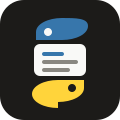

<p align="center">
    
    <h3 align="center">Tate</h3>
    <p align="center">A hands-on introduction to Python, one annotated example at a time.</p>
</p>

## What's inside

59 small Python programs, one topic each — from language basics through the standard library
(no third-party packages yet).

Each folder holds a commented `main.py` you can run on its own (Python 3.12+):

```zsh
$ python3 001_hello/main.py
```

## Website

Read the examples with their output at [tate.clivern.com](https://tate.clivern.com).
To build and preview locally:

```zsh
$ python3 site/build.py
$ python3 -m http.server -d docs
```

## References

- [The Python Tutorial](https://docs.python.org/3/tutorial/)
- [Python language reference](https://docs.python.org/3/reference/)
- [Standard library](https://docs.python.org/3/library/)
